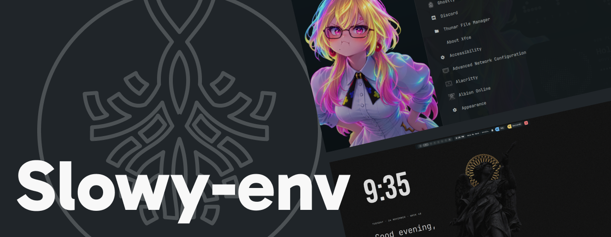

Wayland dotfiles with Quickshell.

## Before you install

Make sure you have these installed first:

- [Quickshell](https://quickshell.outfoxxed.me/) (this whole config runs on it)
- A Wayland compositor, this setup is built around [Hyprland](https://hyprland.org/)
- Python 3 (used by a few helper scripts)
- PipeWire (for audio stuff)
- NetworkManager (for network controls)
- BlueZ / Bluetooth support (for bluetooth controls)

You might also want to have your fonts, icons, and wallpapers set up the way you like. Take a quick look through the config and adjust paths or dependencies to match your system.

## Install the requirements

How you install these depends on your distro, but here is the general idea.

### Arch Linux

```bash
sudo pacman -S hyprland python pipewire pipewire-pulse networkmanager bluez bluez-utils
```

For Quickshell, follow the [official install guide](https://quickshell.outfoxxed.me/).

### Ubuntu / Debian

```bash
sudo apt install python3 pipewire network-manager bluez
```

For Hyprland and Quickshell, check their official docs since the setup can vary by distro and version:

- [Hyprland installation](https://wiki.hyprland.org/Getting-Started/Installation/)
- [Quickshell installation](https://quickshell.outfoxxed.me/)

After installing everything, make sure the services you need are running, like NetworkManager and Bluetooth.

## Reference / inspiration

This config is based on and inspired by [Nebelung-cloud/glyph-rice](https://github.com/Nebelung-cloud/glyph-rice)
